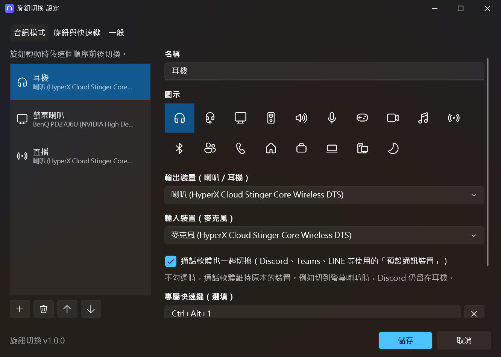
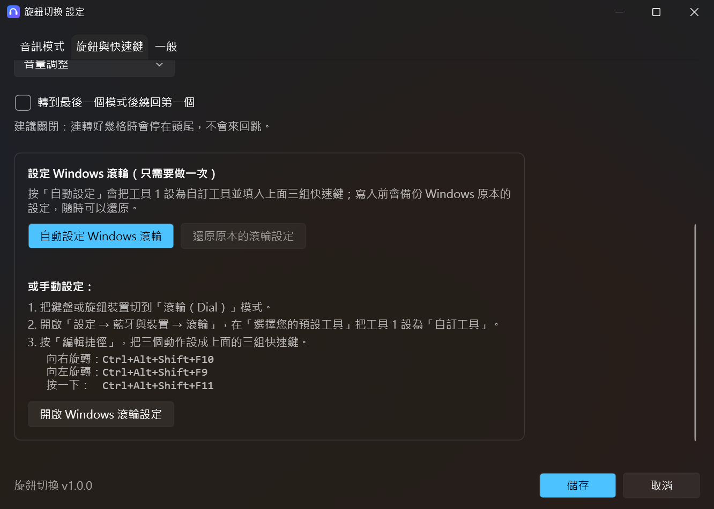
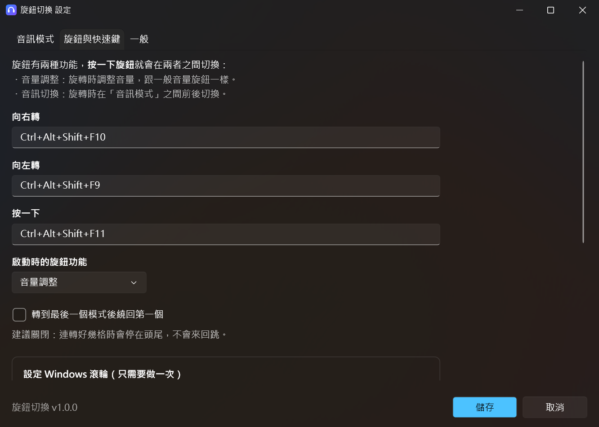
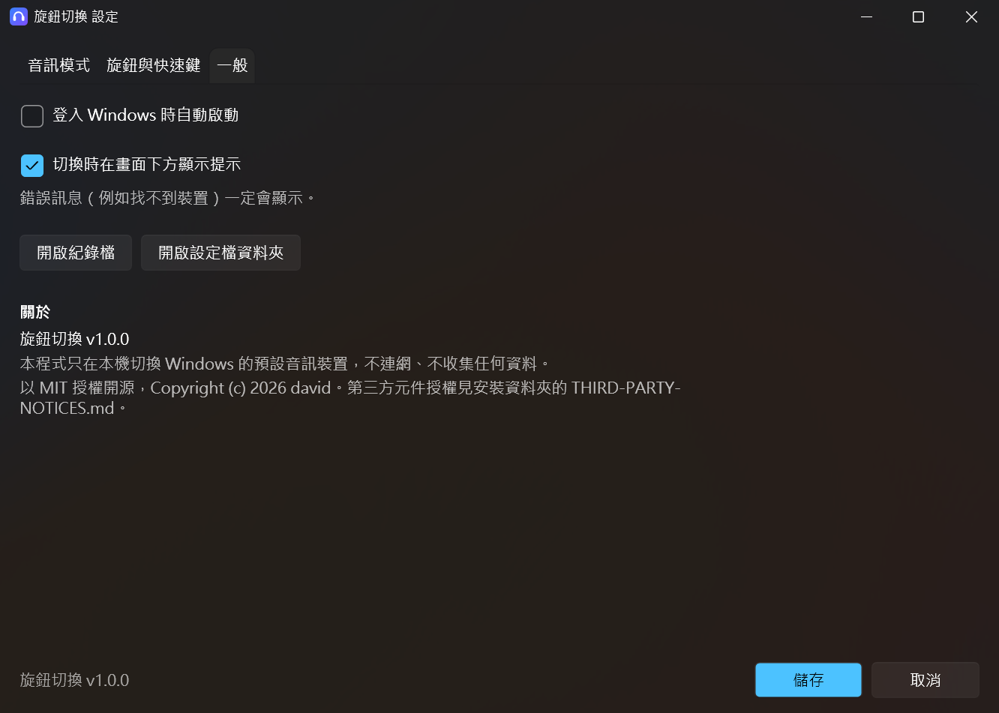

# 旋鈕切換（DialSwitch）

用鍵盤旋鈕（或任何 Windows「滾輪」裝置）快速切換 Windows 的音訊輸出 / 輸入裝置，原本的音量調整功能照常保留。

- **旋鈕功能切換**：按一下旋鈕，在兩種功能之間切換
  - **音量調整**：旋轉時調整音量，跟一般音量旋鈕一樣
  - **音訊切換**：旋轉時在你自訂的「音訊模式」之間前後切換
- **音訊模式**：自訂名稱、圖示、輸出裝置、輸入裝置（麥克風），想建幾個就建幾個，例如「耳機」「螢幕喇叭」「直播」
- **通話軟體分開處理**：可以設定成切到螢幕喇叭時，Discord / Teams 仍留在耳機
- **專屬快速鍵**：每個模式都可以綁一組快速鍵，直接切過去
- 切換時畫面下方會出現提示卡片；系統匣圖示可直接選模式、開設定

支援 Windows 10（1809 以上）/ Windows 11，x64。

<p align="center"></p>

## 使用流程

平常旋鈕就是音量旋鈕；想換裝置時按一下、轉一下，再按一下回到音量。

| 步驟 | 畫面 |
|---|---|
| **1. 平常**：旋鈕功能是「音量調整」，旋轉時跟一般音量旋鈕一樣，Windows 照常顯示音量提示 |  |
| **2. 按一下旋鈕**：切換成「音訊切換」，提示會顯示目前的模式 |  |
| **3. 旋轉**：往右轉切到下一個模式、往左轉切到上一個，提示顯示模式名稱與套用的裝置 | <br> |
| **4. 再按一下旋鈕**：回到「音量調整」 | |
| 裝置沒接上（例如螢幕切到別的輸入來源）時，會顯示紅色提示，不會當掉 |  |

也可以不用旋鈕：每個模式都能設定專屬快速鍵（例如 `Ctrl+Alt+1` 直接切到「耳機」），或在系統匣圖示按右鍵直接選模式。

## 安裝

到發佈頁下載其中一種：

| 檔案 | 說明 |
|---|---|
| `DialSwitch-Setup-<版本>.exe` | **建議**。安裝到使用者資料夾，不需要系統管理員權限；會建立開始功能表捷徑，可從「設定 → 應用程式」解除安裝 |
| `DialSwitch-<版本>-portable.zip` | 免安裝版，解壓縮後直接執行 `DialSwitch.exe` |

兩種都已內含 .NET runtime，不用另外安裝。可以用 `SHA256SUMS.txt` 核對下載的檔案是否完整（PowerShell：`Get-FileHash 檔名`）。

> 執行檔目前沒有數位簽章，第一次執行時 Windows SmartScreen 可能會跳出警告，按「其他資訊 → 仍要執行」即可。

## 第一次設定

### 1. 設定 Windows 滾輪（只需要做一次）

先把鍵盤或旋鈕裝置切到「滾輪（Dial）」模式（依各裝置說明），再選一種方式：

**自動設定（建議）**：下面任一種都可以，寫入前會備份 Windows 原本的滾輪設定，隨時能還原。

- 安裝時勾選「自動設定 Windows 滾輪」（預設勾選）
- 程式的「設定 → 旋鈕與快速鍵」按「自動設定 Windows 滾輪」；「還原原本的滾輪設定」可復原
- 命令列：`DialSwitch.exe --setup-wheel`（還原：`--restore-wheel`）

解除安裝時會自動還原成安裝前的滾輪設定。

**手動設定**：

1. 確認裝置已在「滾輪（Dial）」模式。
2. 開啟「設定 → 藍牙與裝置 → 滾輪」，在「選擇您的預設工具」把**工具 1** 設為「**自訂工具**」。
3. 按「編輯捷徑」，設定三組快速鍵：

   | 動作 | 快速鍵（預設） |
   |---|---|
   | 向右旋轉 | `Ctrl+Alt+Shift+F10` |
   | 向左旋轉 | `Ctrl+Alt+Shift+F9` |
   | 按一下 | `Ctrl+Alt+Shift+F11` |

這三組快速鍵可以在程式的「設定 → 旋鈕與快速鍵」修改，設定頁裡也有同樣的步驟說明和「開啟 Windows 滾輪設定」按鈕。

<p align="center"></p>

沒有滾輪裝置也能用：直接按上面的快速鍵，或在系統匣選單點選模式。

### 2. 建立音訊模式

第一次啟動時會自動依目前的輸出裝置建立模式並打開設定視窗。每個模式可以設定：

- **名稱、圖示**：切換時提示卡片會顯示
- **輸出裝置 / 輸入裝置**：選「（不變更）」就不動那一項
- **通話軟體也一起切換**：勾選時同時設為「預設通訊裝置」（Discord、Teams、LINE 通話等使用）
- **專屬快速鍵**（選填）

<p align="center"></p>

左側清單的順序就是旋鈕切換的順序。建議關閉「轉到最後一個模式後繞回第一個」，這樣連轉好幾格時會停在頭尾，不會來回跳。

> Discord 若要固定在某個裝置，也可以在 Discord 的「語音與視訊 → 輸出裝置」直接指定，不要選「預設」。

## 使用

| 操作 | 效果 |
|---|---|
| 按一下旋鈕 | 切換旋鈕功能：音量調整 ⇄ 音訊切換 |
| 旋轉（音量調整時） | 調整音量 |
| 旋轉（音訊切換時） | 前 / 後一個音訊模式 |
| 模式的專屬快速鍵 | 直接切到該模式 |
| 系統匣圖示：左鍵 | 開啟設定 |
| 系統匣圖示：右鍵 | 選擇模式、開啟紀錄檔、結束 |

<p align="center"></p>

右鍵選單最上面顯示目前的旋鈕功能，目前套用中的模式前面有藍點。程式已在執行時，再從開始功能表開一次會直接打開設定視窗。

「設定 → 旋鈕與快速鍵」可以修改旋鈕的三組快速鍵、啟動時的旋鈕功能，以及轉到頭尾時要不要繞回；「一般」分頁可以開關開機自動啟動與切換提示。

<p align="center"> </p>

## 檔案位置

| 用途 | 位置 |
|---|---|
| 設定檔 | `%APPDATA%\DialSwitch\settings.json` |
| 紀錄檔 | `%LOCALAPPDATA%\DialSwitch\switcher.log`（超過 512 KB 自動輪替） |
| 程式（安裝版） | `%LOCALAPPDATA%\Programs\DialSwitch\` |
| 開機自動啟動 | 登錄 `HKCU\Software\Microsoft\Windows\CurrentVersion\Run` 的 `DialSwitch` |

解除安裝不會刪除設定檔；要完全清除可手動刪掉上面兩個資料夾。

## 隱私與安全

- **不連網**、不收集任何資料；只在本機切換 Windows 的預設音訊裝置。
- 只註冊你設定的那幾組全域快速鍵，**不會**側錄其他按鍵。
- 唯一會模擬的按鍵是「音量加 / 減」（旋鈕在音量調整功能時）。
- 以一般使用者權限執行，不需要也不會要求系統管理員權限。
- 自動設定 Windows 滾輪時只寫入目前使用者的滾輪設定（`HKCU\...\CloudStore\...radialcontrollersettings`），寫入前備份到 `%LOCALAPPDATA%\DialSwitch\wheel-settings-backup.bin`。這個資料格式也沒有公開文件；若自動設定沒有效果，請改用手動設定。
- 切換預設裝置使用 Windows 內部的 `IPolicyConfig` 介面（Windows 音效設定本身也用它）。這個介面沒有公開文件，未來 Windows 更新有可能改變它；若切換失敗，紀錄檔會留下錯誤訊息。

## 開發

需要 [.NET 10 SDK](https://dotnet.microsoft.com/download)。

```powershell
# 開發中：建置並安裝到本機、設定開機啟動、啟動程式
powershell -ExecutionPolicy Bypass -File .\install.ps1

# 發佈：產生安裝程式、免安裝 zip、SHA256SUMS.txt 到 dist\
#（安裝程式需要 Inno Setup 6：winget install JRSoftware.InnoSetup）
powershell -ExecutionPolicy Bypass -File .\build.ps1

# 自我測試：重複執行切換流程（不模擬按鍵、不切換裝置），檢查記憶體與控制代碼是否洩漏，
# 並比對 Windows 滾輪設定的格式；結果在 %LOCALAPPDATA%\DialSwitch\selftest.txt
.\dist\publish\DialSwitch.exe --selftest 2000

# 重新產生 README 截圖（用示範模式，不改任何設定；設定視窗會短暫出現）
.\dist\publish\DialSwitch.exe --doc-shots docs\images

# 重新產生程式圖示
powershell -ExecutionPolicy Bypass -File .\tools\make-icon.ps1
```

| 路徑 | 內容 |
|---|---|
| `src/DialSwitch/` | 主程式（WPF 設定視窗 + WinForms 系統匣與提示卡片） |
| `installer/setup.iss` | Inno Setup 安裝程式腳本 |
| `tools/make-icon.ps1` | 用向量繪製產生 `app.ico` |

### 授權

本專案以 [MIT 授權](LICENSE) 開源，Copyright (c) 2026 david。
發佈檔案內含的 .NET runtime 等第三方元件授權，見 [THIRD-PARTY-NOTICES.md](THIRD-PARTY-NOTICES.md)。

### 版本與更新紀錄

- 版本號遵循[語意化版本](https://semver.org/lang/zh-TW/)，唯一來源是 `DialSwitch.csproj` 的 `<Version>`，安裝程式與設定視窗都從這裡取得。
- 每次發佈前在 [CHANGELOG.md](CHANGELOG.md) 的「未發佈」段落記下變更，發佈時改成新版本號與日期。
